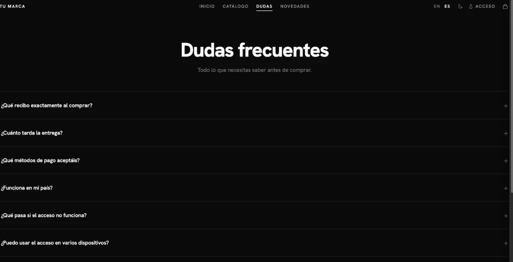

# Digital Supply Template

<div align="center">

**A production-ready e-commerce storefront for digital goods and subscriptions.**  
Live catalog, checkout drawer, customer dashboard, Firebase auth, standalone demo mode, and offline PWA.

[](https://pablooff-tech.github.io/digital-supply-template/)
[](https://github.com/PablooFf-tech/digital-supply-template/actions/workflows/ci.yml)
[](LICENSE)

[](https://developer.mozilla.org/en-US/docs/Web/HTML)
[](https://developer.mozilla.org/en-US/docs/Web/CSS)
[](https://developer.mozilla.org/en-US/docs/Web/JavaScript)
[](https://astro.build)
[](https://firebase.google.com)
[](https://web.dev/progressive-web-apps/)

<br/>



</div>

---

## Overview

A modern digital goods e-commerce storefront built with **Astro** (compiled to static HTML + vanilla JavaScript). It features an integrated client-side demo mode that intercepts `/api/*` calls using a `fetch()` middleware, allowing anyone to preview the complete purchase and dashboard experience without running a backend server.

---

## Architecture

```
┌─────────────────────────────────────────────────────┐
│                   CLIENT (Browser)                  │
│                                                      │
│  template-config.js    →   DOM branding overrides    │
│  demo-mode.js          →   fetch() interceptor       │
│  i18n (runtime)        →   EN / ES instant toggle    │
│  Service Worker        →   Offline cache-first PWA   │
│                                                      │
│  _astro/*.js           →   Optimized Astro bundles   │
│  products_metadata.json→   Product catalog data      │
└───────────────┬─────────────────────────────────────┘
                │ /api/* (intercepted in demo mode)
                │ /api/* (real endpoints in production)
                ▼
┌──────────────────────────┐   ┌─────────────────────┐
│   Backend Server         │   │  Firebase Auth       │
│   Node / Cloudflare / Go │   │  Google / Email / OTP│
│   Stripe / PayPal API    │   └─────────────────────┘
└──────────────────────────┘
```

---

## Key Features

| Feature | Description |
|---|---|
| **Storefront** | Dynamic hero section, ticker bar, live counter metrics, testimonials |
| **Catalog** | Instant live search, category filters, responsive product grid |
| **Product Detail** | Variant selector, live pricing, stock indicators, accordion notes |
| **Checkout Drawer** | Slide-out cart, promo code redemption, simulated checkout flow |
| **Authentication** | Email & password, Google OAuth, passwordless OTP verification |
| **Customer Portal** | Order history, balance management, replacement keys, support tickets |
| **Internationalization** | Instant EN/ES runtime switching without full page reloads |
| **Theming** | Dark & light modes persisted in `localStorage` |
| **Progressive Web App** | Installable app manifest + Service Worker for offline resilience |
| **Zero-Backend Demo** | Full client-side simulation powered by `demo-mode.js` |

---

## Tech Stack

| Layer | Technology |
|---|---|
| **Framework** | [Astro](https://astro.build) (compiled to static, high-performance HTML/JS) |
| **Authentication** | [Firebase Auth](https://firebase.google.com/products/auth) |
| **Styles** | Modern CSS custom properties, oklch color palettes, Hanken Grotesk typography |
| **i18n** | Lightweight vanilla runtime module (English / Spanish) |
| **PWA** | Web App Manifest + Service Worker (`sw.js`) |
| **Deployment** | Vercel, Netlify, GitHub Pages, Cloudflare Pages |

---

## Live Demo

Explore the live demo without installing anything:

👉 **[Launch Live Demo (GitHub Pages)](https://pablooff-tech.github.io/digital-supply-template/)**

---

## Quick Start

### 1. Clone & Run Locally

```bash
git clone https://github.com/PablooFf-tech/digital-supply-template.git
cd digital-supply-template
npm start
# Server listening at http://localhost:4322
```

> **Without Node.js:** Serve the folder directly with VS Code Live Server or `python3 -m http.server 4322`.

### 2. Customize in 3 Steps

1. **`template-config.js`** — Configure your store name, branding, social links, and layout.
2. **`products_metadata.json`** — Add your products, prices, variants, and descriptions.
3. **Connect your backend** — Remove or comment out `<script src="demo-mode.js"></script>` in the HTML files once your backend API is ready.

---

## Directory Structure

```
digital-supply-template/
├── index.html                  # Storefront homepage
├── catalogo.html               # Product catalog with search and filters
├── checkout.html               # Dedicated checkout flow
├── login.html                  # Authentication & OTP modal views
├── customer.html               # Customer account portal
├── product/                    # Product detail pages
├── _astro/                     # Compiled Astro assets (CSS & JS)
├── template-config.js          # Core store configuration & branding
├── demo-mode.js                # API mock middleware for standalone demo
├── i18n-patch.js               # Runtime language switcher
├── sw.js                       # Service Worker (PWA offline caching)
├── manifest.json               # Web App Manifest
├── products_metadata.json      # Product catalog data source
└── firebase-config.js          # Firebase credentials placeholder
```

---

## Production Services Integration

### Firebase Authentication
Set your credentials in `firebase-config.js`:
```js
const firebaseConfig = {
  apiKey: "YOUR_API_KEY",
  authDomain: "your-project.firebaseapp.com",
  projectId: "your-project",
};
```
Enable **Authentication → Email/Password** and **Google** inside your Firebase console.

### Minimum Backend API Endpoints
When transitioning from demo mode to your production server:

| Endpoint | Method | Purpose |
|---|---|---|
| `/api/catalog` | `GET` | Return live product list with inventory status |
| `/api/checkout/create-session` | `POST` | Create Stripe / payment provider session |
| `/api/customer/profile` | `GET` | Authenticated customer profile details |
| `/api/customer/orders` | `GET` | Customer order history & license keys |
| `/api/auth/request-code` | `POST` | Send OTP verification code to email |
| `/api/auth/verify-code` | `POST` | Verify OTP code |

---

## License

This project is licensed under the [MIT License](LICENSE).  
Created and maintained by [Pablo](https://github.com/PablooFf-tech) · [Portfolio](https://myportfollio.bid).
